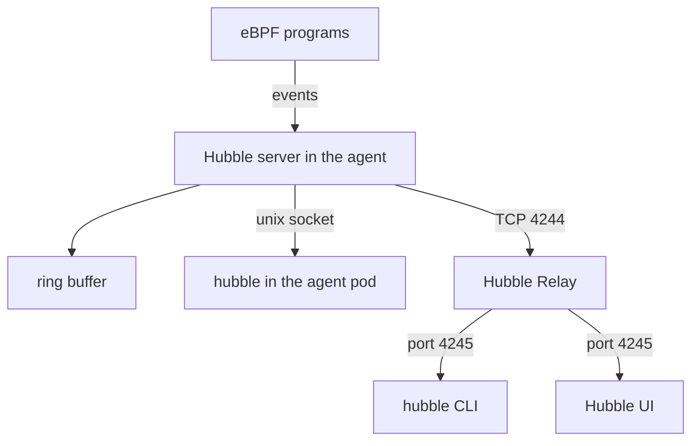

# Hubble Components And Where Flows Come From

A cluster has many nodes and many pods, and traffic between them passes through the network datapath of each node. If you want to know why one request failed, you need a record of that request. Hubble provides this record. Before you can trust what Hubble shows you, you need to know which component creates a record, where it is stored and which component hands it to you. This part follows one flow from the node to your terminal.

## Where a flow is created

Cilium runs as one agent pod on every node. The pod belongs to a DaemonSet called `cilium` in the `kube-system` namespace. The agent loads eBPF programs (small programs that run inside the Linux kernel) that handle every packet to and from the pods of that node. These programs apply network policy, and they also emit an event whenever something notable happens to a packet, for example when a packet is forwarded or dropped.

The agent contains the **Hubble server**, also called the observer. The Hubble server reads those events, adds context to them and stores them as flows. The context includes the names of the pods, the namespaces and the labels that belong to the IP addresses in the event. Because the agent already knows which endpoint owns which IP address, the flow can say `starfleet/shuttle` instead of only `10.244.0.17`.

The Hubble server stores flows in a **ring buffer**, a fixed-size list in memory. When the buffer is full, a new flow replaces the oldest one. The ring buffer is the reason Hubble is not a permanent log: it keeps only the most recent flows of that node.

Each Hubble server listens on a Unix socket inside the agent pod and also on TCP port 4244 on the node. The socket serves clients that run inside the agent pod. The port serves the next component.

## Hubble Relay joins the nodes

One Hubble server only knows the flows of its own node. A request from a pod on node A to a pod on node B leaves flows on both nodes. To see the whole cluster in one place, Cilium runs **Hubble Relay**. Relay is a Deployment named `hubble-relay` in `kube-system` with a Service of the same name. Relay connects to the Hubble server on every node (TCP port 4244), asks each one for its flows and merges the answers into one stream.

The Relay Service listens on port 80 and forwards to Relay on port 4245. A client that talks to Relay therefore sees all nodes that Relay can reach. If a node is not reachable, Relay still answers, but the answer lacks the flows of that node.



The diagram shows that the eBPF programs feed the Hubble server, that the server keeps flows in a ring buffer, and that the command-line tool and the user interface reach many servers through Relay.

## The clients

The **Hubble command-line tool** is a program named `hubble`. It sends a request to a Hubble API and prints the flows it receives. Inside the Cilium agent pod it talks to the local socket, so it shows the flows of that one node. On your own machine it talks to Relay, for example through a port-forward, so it shows the flows of the cluster.

The **Hubble UI** is a web application that draws a service map from the same flows. It always talks to Relay. The UI is an optional component: the command-line tool and Relay work without it.

## Turn Hubble on

Hubble is enabled by default when Cilium is installed with Helm, but Relay and the UI are not. Relay needs its own switch. With Helm you set the value `hubble.relay.enabled=true`. With the Cilium command-line tool, `cilium hubble enable` does the same: it patches the `cilium-config` ConfigMap, restarts the Cilium pods, creates the certificates for Relay and deploys Relay. The UI needs `hubble.ui.enabled=true` in Helm, or `cilium hubble enable --ui`.

The playground already has Relay running. Check the components in the cluster:

<!-- astrona:playground:renew -->

```sh
kubectl -n kube-system get daemonset cilium
kubectl -n kube-system get deployment hubble-relay
kubectl -n kube-system get service hubble-relay
```

You see the `cilium` DaemonSet with one ready pod, the `hubble-relay` Deployment with one ready pod, and a `hubble-relay` Service that exposes port 80. The Hubble UI is not installed in this playground, so no `hubble-ui` objects exist.

The settings that switch Hubble on are keys in the `cilium-config` ConfigMap. Read them:

```sh
kubectl -n kube-system get configmap cilium-config -o yaml | grep -i hubble
```

The keys include `enable-hubble`, which is `"true"`, and `hubble-socket-path`, the Unix socket that the local client uses. Keys with the prefix `hubble-` that are absent mean the feature uses its default or is off. For example, `hubble-metrics-server` is absent because metrics are off.

## Check that Hubble works

The command `hubble status` asks a Hubble API whether it is healthy and prints the state of the ring buffer. Inside the agent pod it asks the local server:

```sh
kubectl -n kube-system exec ds/cilium -c cilium-agent -- hubble status
```

The output has lines for the health check, the current and maximum number of flows, the flow rate and, when the client talks to Relay, the connected nodes. The Hubble documentation shows these lines when a client talks to Relay:

```text
Healthcheck (via 127.0.0.1:4245): Ok
Current/Max Flows: 11917/12288 (96.98%)
Flows/s: 11.74
Connected Nodes: 3/3
```

The numbers belong to that documentation example and your cluster shows its own. Read `Current/Max Flows` as the fill level of the ring buffer. When the current number reaches the maximum, old flows are replaced.

Now read the most recent flows of the node. The `hubble observe` command prints flows, and `--last 5` limits the output to the five most recent ones:

```sh
kubectl -n kube-system exec ds/cilium -c cilium-agent -- hubble observe --last 5
```

Each line is one flow. One line from the documentation looks like this:

```text
Feb 12 19:13:58.111: kube-system/hubble-relay-6467f4f4d-xrxfs:47550 (ID:95552) -> 172.18.0.2:4244 (host) to-stack FORWARDED (TCP Flags: ACK, PSH)
```

That flow shows the Relay pod connecting to the Hubble server port 4244 on a node.

## What this gives you and what it does not

Hubble shows flows that the eBPF programs and the proxies of the node observed. It is a view of network events, not a log of what the applications did. The flows are held in memory, per node, in a buffer of limited size. Relay joins them but does not store them. A client that connects to one agent sees one node, and a client that connects to Relay sees the nodes Relay can reach.

You now know where a flow comes from, where it waits and which component serves it. The open question is how to read one flow, field by field.

## Common pitfalls

> [!WARNING]
> Running `hubble` inside the agent pod shows only that node. On a cluster with several nodes, a missing flow there does not mean the traffic never happened. Relay is not installed by default, so `cilium status` can show Hubble as enabled while no `hubble-relay` Deployment exists. The ring buffer keeps only recent flows, so old events disappear without a message.
