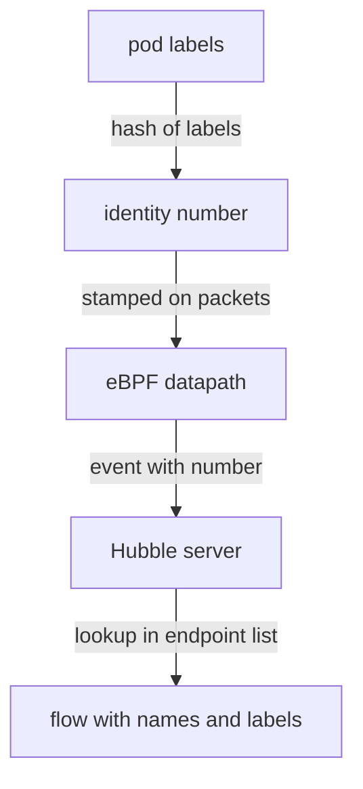

# Identities And Endpoints In A Flow

A flow names its source and destination with pod names, not only with IP addresses. Pods are created and deleted all the time and their IP addresses change, so a record that holds only addresses would be hard to use after the pod is gone. Cilium solves this with identities. This part explains what an identity is, which identities exist for traffic that does not come from a pod, and how to look up the identity that a flow mentions.

## Endpoints and identities

An endpoint is the Cilium name for one workload network interface that the agent manages. On Kubernetes, every pod that uses Cilium for its network is one endpoint. The agent keeps a list of the endpoints of its node, with their IP addresses and labels.

An identity is a number that Cilium gives to a set of labels. All pods with the same security-relevant labels share one identity. When the pod `shuttle` in `starfleet` has the label `app=shuttle`, its identity is derived from that label set and from its namespace. A second pod with the same labels in the same namespace gets the same number. A pod with different labels gets another number.

The identity is the reason a flow can say which workload sent a packet. The datapath marks each packet with the identity of its sender, and the Hubble server translates the number into the labels and the pod name that the agent knows.

## Reserved identities

Not every sender is a pod. Cilium reserves low numbers for special senders. The numbers you meet most often in flows are these:

| Identity | Name | What it stands for |
| --- | --- | --- |
| 1 | `host` | The node itself, including the kubelet and processes on the node |
| 2 | `world` | Any address outside the cluster |
| 4 | `health` | The Cilium health check endpoints |
| 6 | `remote-node` | Another node of the cluster |
| 7 | `kube-apiserver` | The Kubernetes API server, when Cilium can recognise it |

A flow from a pod to an internet address therefore shows the destination as `world`. A flow from a node to a local pod shows the source as `host`. The reserved names are the same in every cluster, so you can search for them in flows and in policies.

## Read the identity in a flow

Start with the flows of the `shuttle` pod. The command asks the Hubble server in the agent for the last two flows that leave `shuttle`:

<!-- astrona:playground:renew -->

```sh
kubectl -n kube-system exec ds/cilium -c cilium-agent -- hubble observe --from-pod starfleet/shuttle --last 2 -o json
```

In the JSON, the object `source` holds the fields `identity`, `namespace`, `pod_name` and `labels`, and the object `destination` holds the same fields for the other side. The labels have a prefix that names where the label came from, for example `k8s:app=shuttle` for a Kubernetes label. The numeric identity is the value that the policy engine used for its decision.

You can also filter by identity. If you copy the numeric identity of the `probe` from the JSON, this command shows the flows that go to it:

```sh
kubectl -n kube-system exec ds/cilium -c cilium-agent -- hubble observe --to-identity <IDENTITY> --last 5
```

Replace `<IDENTITY>` with the number from the JSON. A filter on the identity matches every pod that has this identity, which is wider than a filter on one pod name.

## List identities and endpoints

The agent can print its own tables. The first command lists all identities with their labels. The second lists the endpoints of this node:

```sh
kubectl -n kube-system exec ds/cilium -c cilium-agent -- cilium-dbg identity list
kubectl -n kube-system exec ds/cilium -c cilium-agent -- cilium-dbg endpoint list
```

The identity list shows the reserved identities first and then the identities of your workloads with their labels. The endpoint list shows, for each pod on the node, the endpoint number, the identity, the IP address and whether policy enforcement is on for ingress and egress. Compare the identity column with the numbers in your flows.

Cilium also stores the same information as Kubernetes objects. The commands `kubectl get ciliumidentities` and `kubectl get ciliumendpoints -A` list them without entering the agent pod.



The diagram shows that the packet carries only a number, and the Hubble server adds the names and labels from the agent tables when it builds the flow.

## When the names are missing

Sometimes a flow shows only an IP address or the name `world`. This happens when the address does not belong to an endpoint that the agent knows, for example when a pod has already been deleted, when the address is outside the cluster, or when the flow was recorded before the agent learned the endpoint. A missing name does not mean the flow is invalid. It means the Hubble server could not translate the address when it built the record.

You now know how a number in the datapath becomes a name in a flow, and where to check the mapping. The next question is how the flows of many nodes reach your terminal in a safe way, which depends on the security of Hubble Relay.

## Common pitfalls

> [!WARNING]
> A pod with different labels has a different identity, so a policy written for one identity does not apply to it. Two namespaces with the same labels have different identities, because the namespace is part of the label set. The identity numbers of workloads differ between clusters, so never copy a numeric identity from one cluster into a policy for another. A filter on `world` also matches traffic to any address that Cilium does not know, which includes a pod that was deleted a moment ago.
