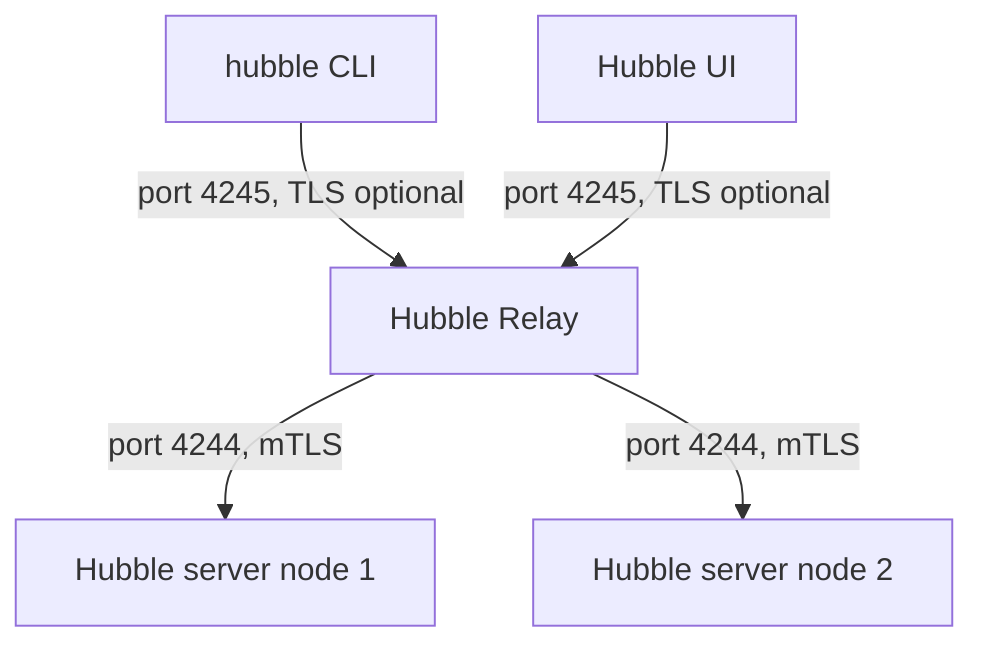

# Hubble Relay Security And TLS

Flows contain names of workloads, ports, and sometimes HTTP paths and DNS names. That is sensitive information about your cluster. Hubble Relay sits between the clients and the Hubble servers of all nodes, so the traffic on both of its sides must be protected. This part explains the two connections that Relay uses, how Cilium secures them with Transport Layer Security (TLS), and how to check the result.

## Two connections, two sides

Relay has a connection to each Hubble server and a connection from each client. They are separate and have separate settings.

The first connection runs from Relay to the Hubble server of each node, on TCP port 4244. Relay is the client and the Hubble server is the server. Cilium enables TLS for this connection by default when it is installed with Helm. Relay and the servers authenticate each other with certificates, which is called mutual TLS (mTLS).

The second connection runs from a client, such as the `hubble` command-line tool or the Hubble UI, to Relay on port 4245. The Relay Service listens on port 80 and forwards to port 4245. TLS on this side is off by default. Anyone who can reach the Relay Service inside the cluster can read the flows, so access to the Service must be controlled with Kubernetes network policy or by keeping the Service private.



The diagram shows that mTLS protects the connection from Relay to the nodes, while the connection from the clients to Relay needs its own setting.

## Where the certificates come from

The Helm value `hubble.tls.enabled` controls TLS for the Hubble server and is `true` by default. The value `hubble.tls.auto.enabled` makes the chart create the certificates, and `hubble.tls.auto.method` chooses how. The default method is `helm`, which generates the certificates when you run `helm install` or `helm upgrade`. The method `cronJob` renews them on a schedule, and `certmanager` asks cert-manager to issue them. The generated certificates are valid for about three years by default, set by `hubble.tls.auto.certValidityDuration`.

The certificates are stored as Kubernetes Secrets in the `kube-system` namespace. Check what exists:

<!-- astrona:playground:renew -->

```sh
kubectl -n kube-system get secrets | grep hubble
```

You see Secrets for the Hubble server certificate and for the certificate that Relay uses as a client. Their names include `hubble-server-certs` and `hubble-relay-client-certs`. A Secret of type `kubernetes.io/tls` holds a certificate and its private key.

The agent reads its TLS settings from the `cilium-config` ConfigMap. Look at them:

```sh
kubectl -n kube-system get configmap cilium-config -o yaml | grep -i "hubble.*tls"
```

The keys name the certificate file, the key file and the certificate authority file that the agent mounts from the Secret. If the key `hubble-disable-tls` is set to `"true"`, the Hubble server does not use TLS at all.

## Secure the client side of Relay

To protect the connection from clients to Relay, you enable the server TLS of Relay with `hubble.relay.tls.server.enabled=true`. With `hubble.relay.tls.server.mtls=true`, Relay also requires a client certificate. A client then needs the matching certificate settings, which the `hubble` tool accepts with the options `--tls`, `--tls-ca-cert-files`, `--tls-client-cert-file` and `--tls-client-key-file`. The UI talks to Relay through its backend and uses its own client certificate when this is enabled.

Check how Relay is configured in the playground. The command prints the Relay configuration file that the chart stores in a ConfigMap:

```sh
kubectl -n kube-system get configmap hubble-relay-config -o jsonpath='{.data.config\.yaml}'
```

The file lists the address of the Hubble peer service, the listen address of Relay and the TLS settings for both sides. In this playground the server side of Relay has TLS off, which matches the chart default.

## What breaks when certificates expire

If a certificate expires or the certificate authority changes, Relay cannot connect to the Hubble servers. Relay keeps running, but the client sees nodes as unavailable. The result looks like missing flows, not like an error in the application traffic. With the method `helm`, you renew the certificates by running `helm upgrade` again, and you then restart Relay so that it loads the new Secrets.

You now know which connection each switch protects. Hubble records the whole cluster, so securing Relay is part of using it. The next module shows how to measure what Hubble sees with metrics.

## Common pitfalls

> [!WARNING]
> Turning on `hubble.relay.tls.server.enabled` breaks every client that does not present the matching settings, including a port-forward used by the `hubble` tool. The method `helm` does not renew certificates on its own. Disabling TLS on the Hubble server with `hubble-disable-tls` stops Relay from connecting if Relay still expects TLS. A flow that is missing from the cluster-wide view can mean that Relay lost its connection to one node.
