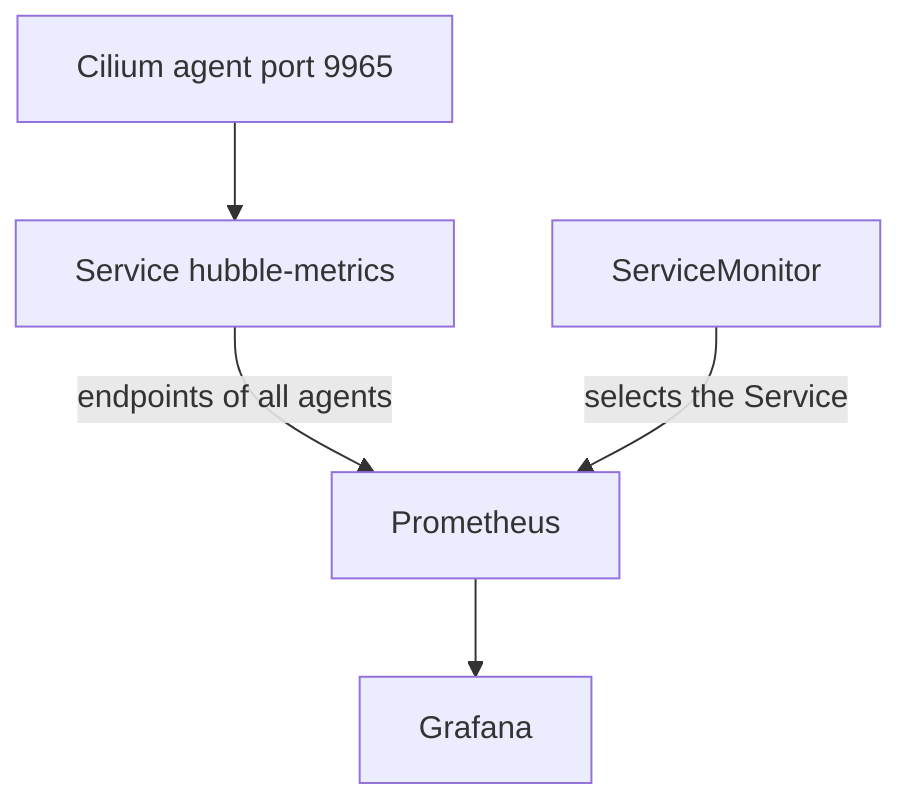

# Scrape Hubble Metrics With Prometheus

The metrics endpoint of one agent is useful for a check, but it has no history and shows one node. Prometheus is a monitoring system that scrapes metrics endpoints on a schedule, stores the values and lets you query and alert on them. This part shows how Hubble metrics reach Prometheus, which Kubernetes objects the Helm chart creates for that, and which queries answer common questions.

## What Prometheus needs

Prometheus pulls metrics. It makes an HTTP request to a target at a fixed interval and reads the text format that the endpoint returns. It needs the list of targets. In Kubernetes, the list comes from either annotations on a Service or Pod, or from a `ServiceMonitor`, which is a custom resource of the Prometheus Operator that tells Prometheus which Services to scrape.

Hubble serves its metrics on port 9965 of every Cilium agent (the Helm value `hubble.metrics.port`, default 9965). The agent exposes the OpenMetrics text format.

## What the Helm chart creates

When you enable metrics with Helm, the chart creates more than the ConfigMap keys. It creates a headless Service named `hubble-metrics` in `kube-system` that selects the Cilium agent pods and exposes port 9965. A headless Service has no virtual address, so a lookup of its name returns the addresses of all agent pods. That is what Prometheus needs, because it must scrape every node.

The chart also adds the annotations `prometheus.io/scrape: "true"` and `prometheus.io/port: "9965"` to the Service. A Prometheus that discovers targets from annotations uses them. If you run the Prometheus Operator, you set `hubble.metrics.serviceMonitor.enabled=true`, and the chart creates a `ServiceMonitor` for the `hubble-metrics` Service. That needs the `ServiceMonitor` custom resource definition to exist before you install the chart.

A value for the Grafana dashboards also exists: `hubble.metrics.dashboards.enabled=true` creates ConfigMaps that hold dashboards, and a Grafana sidecar can load them. The value `hubble.metrics.dashboards.namespace` chooses the namespace of these ConfigMaps.



The diagram shows that Prometheus reaches every agent through the headless Service, and that the `ServiceMonitor` only tells Prometheus which Service to use.

## Set the values with Helm

A single command applies all of this to an existing release. The chart version must match the one that is installed, so read it first:

<!-- astrona:playground:renew -->

```sh
helm -n kube-system list
```

The output shows the release name `cilium` and its chart. A `helm upgrade` that keeps the earlier values and adds the metric settings looks like this, with `<CHART>` replaced by a chart file or reference for your version:

```sh
helm upgrade cilium <CHART> --namespace kube-system --reuse-values --set hubble.metrics.enableOpenMetrics=true --set "hubble.metrics.enabled={drop,flow,tcp}"
```

The braces in `hubble.metrics.enabled` are a Helm list, so the groups are separated by commas here. After the upgrade, the Service exists:

```sh
kubectl -n kube-system get service hubble-metrics
```

If you change only the ConfigMap by hand, as in the earlier exercises, the agent serves metrics but no `hubble-metrics` Service is created, and Prometheus does not find the targets. Helm keeps the ConfigMap and the Service together.

## Queries that answer questions

Prometheus has its own query language, PromQL. These queries use the counters from the earlier part:

- `sum by (reason) (rate(hubble_drop_total[5m]))` is the rate of dropped packets per second over five minutes, split by drop reason.
- `sum by (verdict) (rate(hubble_flows_processed_total[5m]))` is the rate of flows by verdict.
- `increase(hubble_drop_total{reason="POLICY_DENIED"}[1h])` is the number of packets that a policy denied in the last hour.

A counter only grows, so you almost always wrap it in `rate` or `increase`. A rate that drops to zero after a restart of an agent is normal: the counter starts from zero again, and Prometheus handles the reset.

An alert rule can use the same expression. For example, an alert on a policy-denied rate above zero for ten minutes tells you that something keeps sending traffic that a policy refuses. The alert shows that it happens. A flow in Hubble then shows which pods are involved.

You now know the full path of a metric from the agent to a dashboard, and that the metric tells you something changed while the flow tells you what. The last question of this module is how long the flows stay available after the change, which depends on the size of the buffer.

## Common pitfalls

> [!WARNING]
> A `ServiceMonitor` without the Prometheus Operator custom resource definition makes the Helm install fail. A hand-edited ConfigMap does not create the `hubble-metrics` Service. Prometheus scrapes every agent, so a series appears once for each node, and a query must sum across the nodes. A counter that resets to zero after an agent restart is not a loss of data.
