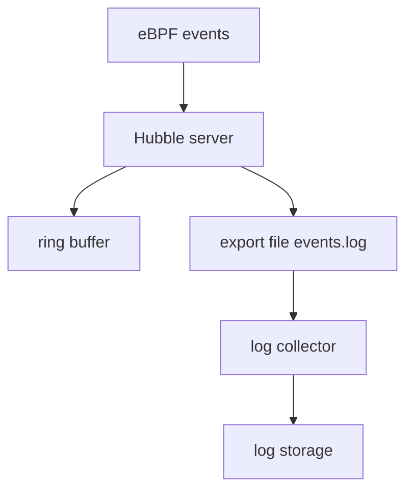

# Why Export Flows

The ring buffer of the Hubble server keeps only the newest flows of one node. On a busy node it can hold less than a minute of traffic. After an incident, the flows that you need may be gone. This part explains what the exporter does about that and what it does not do.

## What the exporter does

The exporter is a feature of the Hubble server in the Cilium agent. For every flow that the server builds, the exporter can also write one line of JSON to a file on the node. The file lives in the agent container, in the directory `/var/run/cilium/hubble/` by default. Each line holds one flow in the same structure that `hubble observe -o json` prints, wrapped in an object that has the key `flow`, the node name and a timestamp.

The exporter does not send the file anywhere. A separate log collector must read it. Common choices are a sidecar container or a node-level collector that tails the file and sends the lines to a log store. The file is the hand-over point between Hubble and your logging system.



The diagram shows that the ring buffer and the export file receive the same flows, and that only the log collector moves the data off the node.

## Export, metrics and the buffer compared

The three outputs answer different questions. The ring buffer gives the newest flows with all fields, fast to read with `hubble observe`, but only for a short time. Metrics give counters for a long time, but no single request. The export file gives full flow records for as long as your log storage keeps them, but you must build and pay for the collection.

Because the exporter writes every selected flow, the file can grow fast. A node with thousands of flows per second produces megabytes per second. This is why filters and rotation matter, and why exporting everything is rarely the right choice.

## Two modes

The static exporter writes one file, with one set of filters, and its settings are keys in `cilium-config`. The agent reads them at start, so a change needs a restart. The dynamic exporter reads a list of exports from a separate ConfigMap and applies changes without a restart, and each entry can have its own file and filters. The next parts configure the static mode first and then explain the dynamic mode.

Check that nothing is exported yet. The first command shows whether any export keys exist, and the second looks for the file:

<!-- astrona:playground:renew -->

```sh
kubectl -n kube-system get configmap cilium-config -o yaml | grep hubble-export
kubectl -n kube-system exec ds/cilium -c cilium-agent -- ls /var/run/cilium/hubble
```

The first command prints nothing because no export key is set. The second command lists the directory without an export file, or reports that it does not exist.

You now know what the exporter adds and why it needs care. The next step is to turn it on.

## Common pitfalls

> [!WARNING]
> The export file belongs to one node, so a cluster with several nodes has one file per node and the collector must run on each node. The exporter is not an audit guarantee: flows that the datapath never reported are not in the file. Exported flows can contain pod names and HTTP paths, so protect the log storage like any other sensitive data.
