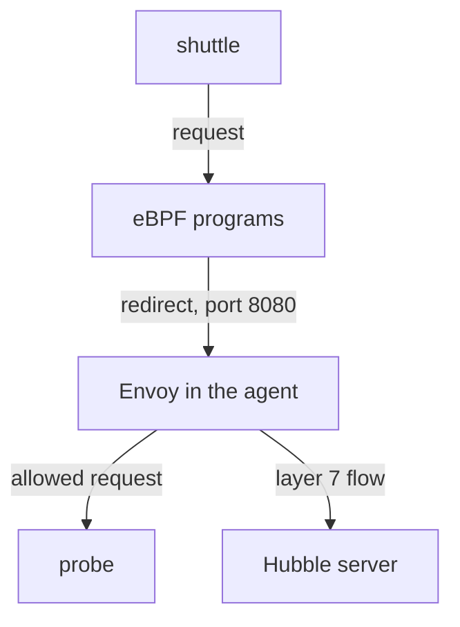

# How Layer 7 Visibility Works

A team asks which HTTP requests reach a service, and the flows only say that a TCP connection to port 8080 was forwarded. The flows are correct, but they cannot answer the question. Cilium can answer it for selected pods, at a price. This part explains the layers, the component that reads HTTP, the way traffic reaches it and what the proxy changes for the traffic.

## Layers and what each flow can show

Network traffic is described in layers. Layer 3 is the IP (Internet Protocol) layer with source and destination addresses. Layer 4 is the transport layer with TCP (Transmission Control Protocol) or UDP (User Datagram Protocol) and the ports. Layer 7 is the application layer, where protocols such as HTTP (Hypertext Transfer Protocol) and DNS (Domain Name System) live.

The eBPF programs in the kernel work on layers 3 and 4. They can see addresses, ports and TCP flags. They do not parse the content of a connection. A flow produced from these events has the type `L3_L4`. It shows who talked to whom and the verdict, and nothing about the request.

A layer 7 flow has the type `L7`. It describes one request or one response of an application protocol: for HTTP the method, the URL, the status code and the latency. Something must read the protocol to produce it, and in Cilium that is the Envoy proxy.

## The proxy in the agent

Envoy is a proxy that Cilium runs inside the agent pod. In Cilium, it is not a sidecar in each application pod. The agent configures one Envoy for the node, and the agent tells it which traffic to parse and which rules to enforce.

The eBPF programs decide which traffic goes to the proxy. When a policy with a layer 7 rule selects an endpoint, the programs redirect the matching connections of that endpoint to the proxy. The proxy terminates the application connection, reads each request, applies the rules, and then forwards the request to the real destination or answers with an error. At the same time, it reports each request and response to the Hubble server as a layer 7 flow.



The diagram shows that a request from the `shuttle` pod is redirected by the eBPF programs to Envoy, that Envoy sends allowed requests to the `probe` pod, and that Envoy reports every request to the Hubble server.

## Visibility and enforcement come together

Cilium has no separate switch that only watches HTTP. The redirect happens because a policy rule at layer 7 exists for that endpoint and port. The rule is therefore both the way to see the traffic and a restriction on it. Once the redirect is active, the proxy enforces the rule: a request that matches is forwarded, and a request that does not match is rejected.

This has two consequences. First, you cannot add visibility to a pod without defining what is allowed at layer 7 for that port. If you write a rule that is too narrow, the pod loses traffic that worked before. Second, a layer 7 rule only exists inside a policy for a port. A rule for `GET /get` on port 8080 does not affect any other port of the same pod.

## Look at the layer 4 policy first

The playground has a policy that works at layer 4 only. Read it:

<!-- astrona:playground:renew -->

```sh
kubectl -n starfleet get cnp probe-ingress -o yaml
```

The command prints the policy. `cnp` is the short name for `CiliumNetworkPolicy`. The `spec` has an `endpointSelector` for the label `app: probe`, and one ingress rule from endpoints with the label `app: shuttle` to TCP port 8080. There is no `rules` block under `toPorts`, so the policy works at layer 4 only.

Send a request from `shuttle` and read the resulting flows. The request goes to the Service name `probe` in the same namespace:

```sh
kubectl -n starfleet exec shuttle -- curl -s -o /dev/null -w "%{http_code}\n" http://probe:8080/get
kubectl -n kube-system exec ds/cilium -c cilium-agent -- hubble observe --pod starfleet/probe --since 1m
```

The request returns `200`, and the flows show TCP traffic between `starfleet/shuttle` and `starfleet/probe` with the verdict `FORWARDED`. The lines have no HTTP fields, because no proxy has seen the traffic.

You can confirm that no HTTP flow exists with the type filter. The filter `-t l7` selects layer 7 flows:

```sh
kubectl -n kube-system exec ds/cilium -c cilium-agent -- hubble observe -t l7 --since 1m
```

The command prints no flows, because no policy sends the traffic to the proxy.

## What the proxy costs and cannot do

Every redirected connection passes through the proxy. The proxy parses each request, so the traffic needs more processing and adds some latency. That is why Cilium does not do this for all traffic by default, and why you use layer 7 rules only where the detail is worth the cost.

The proxy can read only protocols it understands and only when the content is readable. HTTPS (HTTP over TLS, Transport Layer Security) is encrypted between the client and the server. The proxy sees only encrypted bytes, so it cannot read the method or the path, and no HTTP flow appears. Traffic that the application encrypts end to end stays visible only at layer 3 and 4. Terminating TLS in the proxy is possible with additional configuration, but it is outside the basic case.

The proxy also does not change what reaches the application when a request is allowed. The application still receives the same request. A denied request never reaches the application: the proxy answers it.

## Ports and the scope of a rule

A layer 7 rule belongs to a port. The policy names a port and a protocol under `toPorts`, and the `rules` block under it applies to that port only. The kernel programs redirect only the connections to that port to the proxy. A connection to another port of the same pod stays at layer 4 and stays visible only as layer 4 flows.

The rule also has a direction. A rule in an `ingress` section applies to connections that arrive at the selected pod, and the proxy sits on the path to the server. A rule in an `egress` section applies to connections that leave the selected pod. For HTTP, the usual place is ingress on the server, because the owner of the service decides which requests it accepts. For DNS, the place is egress on the client, as the next module shows.

## The order of the checks

A request passes two checks. First, the layer 3 and layer 4 part of the policy: is the source allowed to reach this port at all? The kernel programs decide this, and a source that is not allowed is dropped before the proxy is involved. Second, the layer 7 part: does the request match an HTTP entry? The proxy decides this. You must therefore read two places when a request fails. A drop without HTTP fields is the first check. A drop with HTTP fields, or a 403 answer, is the second check.

This order is also the reason that a layer 7 rule does not weaken the layer 4 rule. A source that is not in `fromEndpoints` stays denied, no matter what the HTTP entries say. The HTTP entries only narrow what an allowed source may do.

## When not to use a layer 7 rule

A layer 7 rule is a good fit when the detail is needed and the traffic is plain HTTP. It is a poor fit for encrypted traffic, for protocols that the proxy cannot parse and for very high-volume paths where the extra processing is not acceptable. In those cases the flows at layer 4, the metrics and the logs of the application give the evidence you need.

## What to remember

Layer 4 flows come from the kernel programs and show the connection. Layer 7 flows come from Envoy and show the request. The redirect to Envoy happens because a layer 7 policy rule selects the endpoint, so visibility and enforcement are one feature. You pay for it with extra processing and you lose it for encrypted content.

You now know where HTTP flows come from and why a policy is needed to get them. The open question is what such a policy looks like and what the flows and the denied requests look like in practice.

## Common pitfalls

> [!WARNING]
> There is no HTTP visibility without a layer 7 rule, and a layer 7 rule also restricts the traffic of that port. A rule on one port does not show or restrict other ports. HTTPS traffic stays opaque to the proxy, so a missing HTTP flow for an HTTPS request is expected. Layer 4 flows with `FORWARDED` do not mean that the request was allowed at layer 7.
