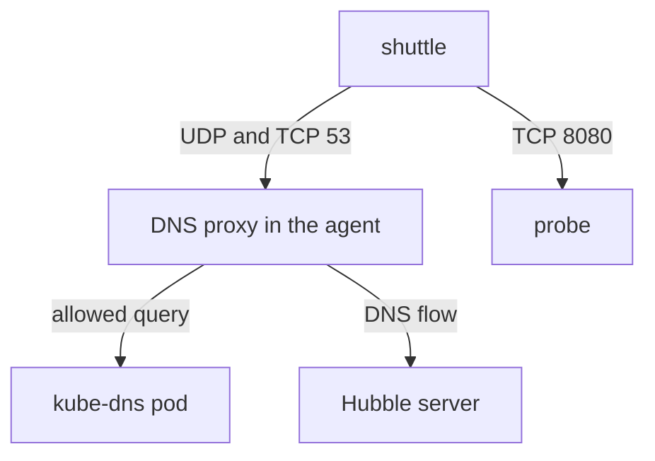

# How DNS Visibility Works

When a request to `http://probe.starfleet:8080` fails with "could not resolve host", the network is not the first suspect, yet the failure looks like a network problem. DNS is the step before every connection by name, and it fails in its own ways. Hubble can show each lookup, with the name and the answer. To use that view you must know the path of a lookup, which component reads it and what the required policy does to the pod.

## The path of a DNS lookup in Kubernetes

A pod does not resolve names itself. The container runtime writes a file `/etc/resolv.conf` into each pod. In a Kubernetes cluster, the file points at the cluster DNS Service, usually backed by the CoreDNS pods in `kube-system` with the label `k8s-app=kube-dns`. The file also lists search domains, such as `starfleet.svc.cluster.local`, so that the short name `probe` expands to `probe.starfleet.svc.cluster.local`.

A lookup from a pod therefore sends a UDP packet to the cluster DNS Service on port 53. The resolver in the pod may try several names from the search list, so one request by short name can cause several lookups, and the first ones can end with a "name not found" answer. This is normal. It is also the reason that DNS traffic is larger than the number of requests in an application.

You can look at the file in the playground:

<!-- astrona:playground:renew -->

```sh
kubectl -n starfleet exec shuttle -- cat /etc/resolv.conf
```

The file lists a `nameserver` line with the address of the cluster DNS Service, a `search` line with the search domains and an `options` line. Those lines belong to your cluster, so read them on your own system.

## Why layer 4 flows show no names

A DNS lookup is a UDP packet to port 53. The kernel programs see the addresses and the port, and they record a flow with the verdict `FORWARDED`. They do not parse the DNS message. Without a proxy, the flow shows a pod talking to the DNS pod on UDP 53, and nothing about which name was asked.

You can see this in the playground. Send a request by name, and read the UDP flows of the pod:

```sh
kubectl -n starfleet exec shuttle -- curl -s -o /dev/null -w "%{http_code}\n" http://probe.starfleet:8080/get
kubectl -n kube-system exec ds/cilium -c cilium-agent -- hubble observe --pod starfleet/shuttle --protocol UDP --since 1m
```

The request prints `200`. The flows show UDP traffic from `shuttle` to the DNS pod, port 53, with the verdict `FORWARDED`, but the lines carry no query name.

## The DNS proxy

Cilium has a DNS proxy in the agent. When an egress policy has a `dns` rule for a pod, the kernel programs redirect the DNS traffic of that pod, on the port in the rule, to the DNS proxy. The proxy reads each query, checks it against the rule, forwards allowed queries to the real DNS server and reports the query and the answer to the Hubble server. This is how a DNS flow, with the name and type of the query, comes to exist.

The proxy has a second job in policies that use DNS names as targets. A rule that allows egress to a name such as `example.com` needs to know the IP addresses of the name, and the proxy learns them from the answers it forwards. This is how a policy can be written with names and still be applied on IP addresses. That feature is outside this module, but it explains why Cilium has a DNS proxy at all.

## Why egress only

The DNS proxy sits on the egress path of the client pod, where the query leaves it. The query goes to the cluster DNS, which is a server in another pod. For visibility of that server's side, an ingress rule would be needed, and Cilium shows DNS only through egress rules at the client. In practice, you attach the DNS rule to the pod that asks the questions, and you see all the lookups of that pod.

## What the egress policy restricts

Cilium enforces a policy for a direction as soon as one policy selects the endpoint for that direction. Before any egress policy selects `shuttle`, all its egress is allowed. After you apply a policy with an egress rule that selects `shuttle`, only the egress that policies explicitly allow works. Everything else is denied.

This is the most important point of the module. If you add an egress rule only for DNS, then DNS works and the request to the `probe` stops, because the egress to the `probe` is no longer allowed. The policy must therefore list the DNS egress and also every other egress that the pod needs. For `shuttle`, that is the cluster DNS on port 53 and the `probe` on port 8080.



The diagram shows that the DNS traffic of `shuttle` goes through the DNS proxy, which reports each query to the Hubble server, and that the traffic to the `probe` goes direct, if the policy allows it.

## Both transports

DNS uses UDP for most queries and TCP for large answers and for some clients. A rule that lists only UDP port 53 leaves the TCP lookups without a path, and those fail in a way that is hard to notice because most lookups still work. The rule therefore lists both UDP and TCP on port 53.

## Search domains and the number of lookups

The `search` line in `/etc/resolv.conf` and the `ndots` option decide how a resolver expands a name. With the common value `ndots:5`, a name with fewer than five dots is first tried with each search domain added, and only after those fail is it tried as written. For the short name `probe` in the namespace `starfleet`, the resolver can ask for `probe.starfleet.svc.cluster.local` first, and the answer succeeds at once. For an external name such as `example.com`, the resolver first asks for the name with each cluster search domain added, receives name-not-found answers, and only then asks for the real name.

This explains two facts that surprise people. A single request to an external name can produce several DNS flows, and most of them end with the answer code for a name that does not exist. And the DNS traffic of a busy pod is much larger than its request rate. When you read DNS flows, you therefore look for the final successful query and for answers with an error code that does not fit the pattern, and you do not count every flow as a problem.

## Who answers: the cluster DNS and its limits

The cluster DNS answers names that belong to the cluster, such as Service names, from the Kubernetes API. For other names, it forwards the query to an upstream resolver, which is set in its own configuration. The Cilium DNS proxy sits between the pod and the cluster DNS and sees the query before the cluster DNS does. It does not replace the cluster DNS and it does not cache answers for the pod.

Because of this arrangement, a DNS flow shows the traffic between the pod and the cluster DNS only. It does not show the queries that the cluster DNS sends to the upstream resolver. If the upstream resolver is slow or fails, the flows of the pod show a query that stays without an answer or an answer with a server-failure code, and you must look at the cluster DNS to find the cause.

## A failed lookup, step by step

Suppose a request fails with a message that the host cannot be resolved. A layer 4 flow list shows UDP traffic to port 53 that was forwarded, so it cannot tell whether the answer was correct. With the DNS proxy, you can follow the lookup. The query flow shows the exact name that the resolver asked for, which can reveal a typo or a missing namespace in the name. The response flow shows the response code, and the code for a non-existing name shows that the DNS server has no record for the name. A refused query with the verdict `DROPPED` shows that a DNS rule in the policy did not allow the name. No response at all points to a blocked path to the DNS server, which is a layer 4 problem and not a DNS content problem.

Each of these results leads to a different repair: correct the name, create the Service, widen the DNS rule or open the path to the DNS pods. The DNS flows let you pick the right one.

## What to remember

The kernel programs see a DNS lookup only as UDP traffic to port 53. The DNS proxy reads the names, and it is switched on by an egress policy with a `dns` rule. That policy turns on egress enforcement for the pod, so it must also allow all other egress that the pod needs. Lookups use UDP and TCP.

You now know why a DNS flow needs a policy and what that policy costs. The open questions are how to write the policy, how to read the DNS flows and where the limits of layer 7 visibility lie.

## Common pitfalls

> [!WARNING]
> An egress policy with only a DNS rule blocks every other egress of the pod. A short name can produce several lookups because of the search domains, and lookups that end with "not found" are normal. Listing only UDP leaves TCP lookups blocked. DNS flows with names exist only for pods that an egress `dns` rule selects.
