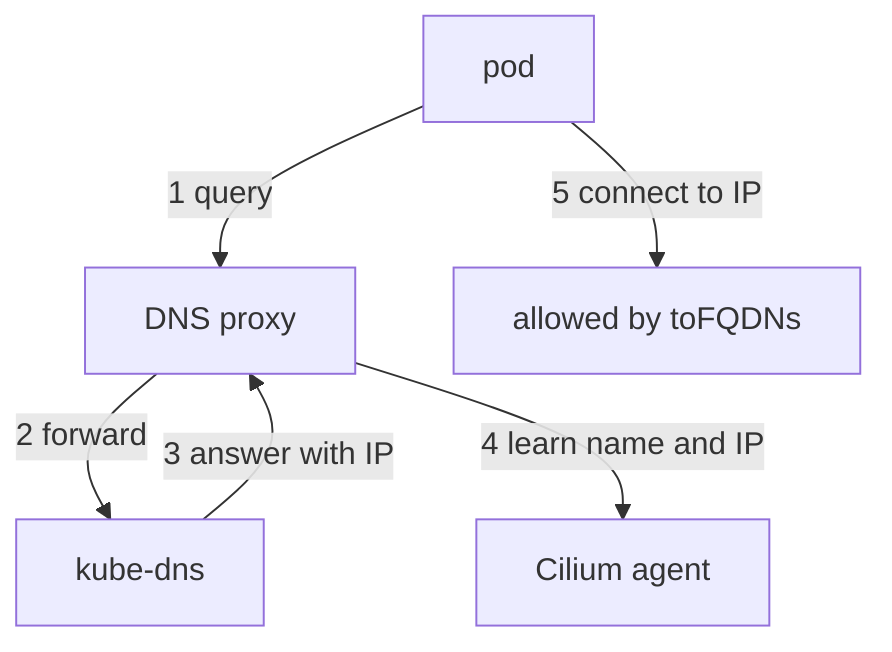

# FQDN Selectors And Name Patterns

A DNS rule controls which names a pod may look up. A second feature, the fully qualified domain name (FQDN) selector, controls which addresses a pod may connect to by their names. The two features work together, and mixing them up is a common error. This part explains both and how a name becomes an allowed address.

## Two different jobs

The `dns` rule sits under `toPorts` of the egress rule that points at the DNS server. It allows or refuses the query itself. A query for a name that the rule does not list receives the answer `REFUSED`.

The `toFQDNs` selector sits in an egress rule of its own. It allows connections to the IP addresses that belong to the listed names. Its fields are `matchName` for an exact name and `matchPattern` for a pattern with the wildcard `*`. For example, `matchName: api.example.com` allows connections to the addresses that this name returned.

The two need each other. `toFQDNs` knows an address only if the pod looked the name up through the DNS proxy, so the DNS rule must allow the lookup. Without a DNS rule, the agent never sees the answer, and the connection stays denied.



The diagram shows that the DNS proxy records the answer, and the agent then allows the connection to that address.

## Pattern rules

A `matchPattern` uses `*` to stand for any characters inside one label. The pattern `*.example.com` matches `api.example.com`. It does not match `example.com` itself and does not match `a.b.example.com`, because the star does not cross dots in the `toFQDNs` selector. For the DNS rule, the pattern `*` alone matches every name, which is the form used for visibility.

Names in a policy are written in lower case without a trailing dot. DNS answers compare case-insensitively, but a pattern with upper case letters can fail to match.

## Narrow the lookups

You can test the DNS rule in the playground without internet access. This policy lets `shuttle` look up only the name of the `probe` Service and connect to it. Save this as `shuttle-egress-narrow.yaml`:

```yaml
apiVersion: cilium.io/v2
kind: CiliumNetworkPolicy
metadata:
  name: shuttle-egress
  namespace: starfleet
spec:
  endpointSelector:
    matchLabels:
      app: shuttle
  egress:
  - toEndpoints:
    - matchLabels:
        io.kubernetes.pod.namespace: kube-system
        k8s-app: kube-dns
    toPorts:
    - ports:
      - port: "53"
        protocol: ANY
      rules:
        dns:
        - matchName: probe.starfleet.svc.cluster.local
  - toEndpoints:
    - matchLabels:
        app: probe
    toPorts:
    - ports:
      - port: "8080"
        protocol: TCP
```

Apply it:

<!-- astrona:playground:renew -->

```sh
kubectl apply -f shuttle-egress-narrow.yaml
```

Then check the result. The first request uses the full allowed name and the second uses a name that the rule does not list:

```sh
kubectl -n starfleet exec shuttle -- curl -s -o /dev/null -m 5 -w "%{http_code}\n" http://probe.starfleet.svc.cluster.local:8080/get
kubectl -n starfleet exec shuttle -- curl -s -o /dev/null -m 5 -w "%{http_code}\n" http://other.starfleet:8080/get
```

The first request prints `200`. The second prints `000`, because curl cannot resolve the name: the proxy refused the query. Hubble shows the refused query as a dropped DNS flow.

You now know how the name rule and the address rule split the work. The proxy that sits in the middle has behaviour of its own, such as caching, that decides how long an allowed address stays allowed.

## Common pitfalls

> [!WARNING]
> `toFQDNs` is meant for names that resolve to addresses outside the cluster, not for in-cluster Services. A `toFQDNs` rule without a matching `dns` rule never allows a connection. The pattern `*.example.com` does not cover `example.com`. A pod that uses a hard-coded IP address never looks up a name, so no FQDN rule can allow it.
