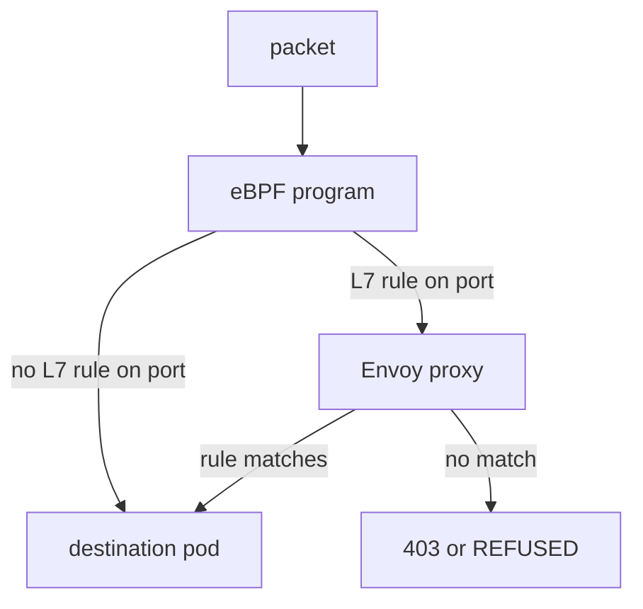

# What The Proxy Can Parse

Layer 7 visibility is not a general switch. It exists only for protocols that the Cilium proxy knows how to read, and only for traffic that a rule selects. This part lists both limits so that you can predict, before you apply a policy, whether Hubble will show request details.

## The proxy and the redirect

The proxy is Envoy. Envoy is an open-source proxy that reads a protocol and applies rules to each request. Cilium runs Envoy either inside the agent or, in current releases, as a separate DaemonSet named `cilium-envoy` in `kube-system`. Either way, one Envoy serves all pods of a node.

The eBPF programs in the kernel decide which traffic goes to Envoy. A packet to a port that a layer 7 rule selects is redirected to the proxy. Envoy parses the protocol, checks the rule, forwards or refuses the request and reports an event that Hubble turns into a layer 7 flow. Traffic that no layer 7 rule selects never reaches Envoy and produces only layer 3 and layer 4 flows.

## Which protocols

The protocols that the Cilium proxy parses in policy rules are HTTP (including gRPC, which travels over HTTP/2) and DNS. Cilium also had a Kafka parser, which newer releases deprecate, so you should not build new designs on it. Any other protocol, such as a database wire protocol, a message queue protocol or plain TCP, shows only as layer 4 flows.

You can check what the node does in the playground. The first command lists the pods of the proxy, and the second checks whether the policy of the `probe` has any layer 7 rule:

<!-- astrona:playground:renew -->

```sh
kubectl -n kube-system get pods | grep -i envoy
kubectl -n starfleet get ciliumnetworkpolicy probe-ingress -o jsonpath='{.spec.ingress[*].toPorts[*].rules}'
```

The first command shows the `cilium-envoy` pod when the proxy runs as its own DaemonSet. In older installations, no such pod exists because Envoy runs inside the agent. The second command prints nothing: the policy has no `rules`, so no traffic of the `probe` goes through the proxy yet.

## Selecting traffic

A layer 7 rule selects traffic by the port in the same `toPorts` entry. All traffic to that port of the selected endpoints goes through the proxy, and a request that does not match a rule is refused. This is why a visibility rule for one port cannot be limited to a few requests: it applies to every request on that port.



The diagram shows that the kernel sends only the selected port to Envoy, and that Envoy either forwards the request or refuses it.

You now know where layer 7 data comes from and where it stops. The most common case that stops it is encryption, which the next part explains.

## Common pitfalls

> [!WARNING]
> A layer 7 rule on a port applies to all traffic on that port. Traffic of an unsupported protocol on that port can break, because the proxy cannot parse it. A pod without a layer 7 rule never has layer 7 flows, even if its traffic is HTTP. Do not build on Kafka policy rules in new designs, because the feature is deprecated.
