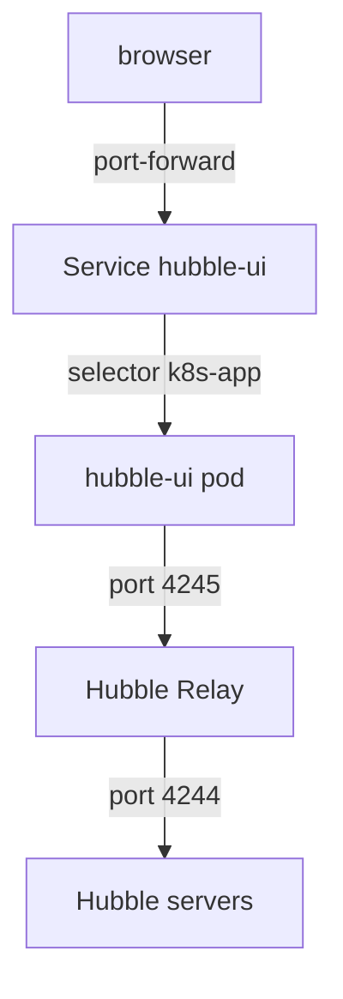

# Hubble UI Components And Access

A person tries to open the Hubble UI and gets a connection error. The cause can be in the pod, in the Service that points to the pod, in the connection between the UI and Relay or in the way the person reaches the cluster. If you know the path from the browser to the flows, you can check each link in order. This part follows that path and then shows how to repair a broken Service.

## What the UI is made of

The Hubble UI is a Deployment named `hubble-ui` in the `kube-system` namespace. Its pod runs a web front end that serves the pages and a backend that talks to Hubble Relay. The backend asks Relay for flows and sends the result to the browser. The UI does not read flows from the agents directly, so Relay must work for the UI to show anything.

A Service named `hubble-ui` exposes the pod inside the cluster. It listens on port 80 and forwards to port 8081 of the pod. The Service finds its pods through a label selector, and for the UI the selector is `k8s-app: hubble-ui`. A Service has no pods of its own: Kubernetes keeps a list of the addresses of the ready pods that match the selector. That list is the Endpoints object of the Service. If the list is empty, a request to the Service has nowhere to go.

The UI is optional. It is off by default and you turn it on with the Helm value `hubble.ui.enabled=true`, or with the command `cilium hubble enable --ui`. The UI needs Relay, so enabling the UI also needs Relay to be enabled.



The diagram shows that the browser reaches the Service through a port-forward, that the Service selects the UI pod by label, that the UI pod asks Relay for flows and that Relay asks the Hubble server of each agent.

## Open the UI

The UI has no external address by default. The simplest way to reach it is a port-forward to the Service. The Cilium command-line tool has `cilium hubble ui`, which opens a forward and starts a browser. The same forward with `kubectl` is:

```sh
kubectl -n kube-system port-forward service/hubble-ui 12000:80
```

The command stays in the foreground while the forward is active. Open `http://localhost:12000` in a browser while it runs. The port 12000 on your machine is forwarded to port 80 of the Service.
Before you do that, check the objects. Run these in the playground:

<!-- astrona:playground:renew -->

```sh
kubectl -n kube-system get deployment hubble-ui
kubectl -n kube-system get service hubble-ui
kubectl -n kube-system get endpoints hubble-ui
```

The Deployment shows how many replicas are ready. The Service shows its port. The Endpoints object lists the addresses of the pods that back the Service. In a healthy UI, the Endpoints object has one address with port 8081.

## Diagnose a Service without endpoints

If the Endpoints object shows `<none>` or an empty address list, the Service has no usable pods. Check the causes in this order, because each one is cheap to check.

First, the replicas. A Deployment that is scaled to zero has no pods, so no address can exist. The `READY` column of the Deployment shows `0/0` in that case. The fix is to scale it up:

```sh
kubectl -n kube-system scale deployment hubble-ui --replicas=1
```

Second, the selector. If the selector of the Service does not match the labels of the pod, the Service never selects the pod, even when the pod is ready. Compare both:

```sh
kubectl -n kube-system get service hubble-ui -o jsonpath='{.spec.selector}'
kubectl -n kube-system get pods -l k8s-app=hubble-ui --show-labels
```

The first command prints the selector map of the Service. The second lists the pods that carry the correct label and shows their labels. If the selector has a typo, the two do not agree, and you repair the Service by writing the correct selector. A merge patch changes only the selector:

```sh
kubectl -n kube-system patch service hubble-ui --type merge -p '{"spec":{"selector":{"k8s-app":"hubble-ui"}}}'
```

A merge patch on a map merges keys. If the broken selector had a different key, the old key would stay next to the new one, and the Service would still match nothing. In that case, use a JSON patch with the operation `replace` on `/spec/selector`, which sets the whole map:

```sh
kubectl -n kube-system patch service hubble-ui --type json -p '[{"op":"replace","path":"/spec/selector","value":{"k8s-app":"hubble-ui"}}]'
```

Third, the pod state. A pod can exist and match the selector and still be absent from the Endpoints, because it is not ready. A readiness probe that fails keeps the address out of the list. The commands `kubectl describe pod` and `kubectl logs` for the pod show why.

After a repair, check the Endpoints again. The address appears within a few seconds, and the UI answers on the forwarded port.

## When the UI opens but shows nothing

If the page opens and the map stays empty, the UI works but has no flows. Check Relay first, as the UI depends on it:

```sh
kubectl -n kube-system get deployment hubble-relay
```

Then check that traffic exists in the namespace you selected, with `hubble observe` on the command line. The UI shows flows only for the selected namespace and the time since you opened the page, so an empty namespace shows an empty map.

You now know the parts of the UI, how to reach it and how to find out why the Service has no endpoint: replicas, selector and readiness. With the UI open, the next question is how to read what it shows.

## Common pitfalls

> [!WARNING]
> A merge patch on a selector map adds keys and does not remove old ones, so use a JSON patch with `replace` when the key itself is wrong. A Service with a correct selector still has no endpoint if the Deployment has zero replicas or the pod is not ready. The UI needs Relay. A port-forward ends when the terminal closes it, and the page then stops loading.
