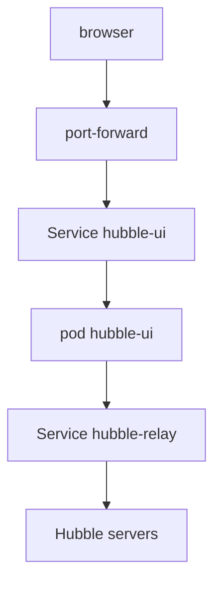

# Troubleshooting The Hubble UI

When the Hubble UI does not load, the cause lies in one of four places: the browser connection, the Service, the UI pod, or the link to Relay. This part gives a fixed order of checks, from the browser side to Relay, so that you find the fault with a few commands.

## The path of a request

The browser reaches the UI through a port-forward or an ingress. The path then goes to the Service `hubble-ui`, which forwards port 80 to port 8081 of the UI pod. The UI backend in that pod calls Hubble Relay on its Service. Each step can fail alone.



The diagram shows the chain from the browser to the Hubble servers. The fault is at the first link that does not work.

## Check from the Service side

First, check that the Deployment is ready and that the Service has endpoints. An empty endpoints list means that no ready pod matches the selector:

<!-- astrona:playground:renew -->

```sh
kubectl -n kube-system get deployment hubble-ui
kubectl -n kube-system get endpoints hubble-ui
```

If the Deployment is not ready, read the pods and their events:

```sh
kubectl -n kube-system get pods -l k8s-app=hubble-ui
kubectl -n kube-system describe pod -l k8s-app=hubble-ui
```

A pod that is `Pending` points at scheduling or image problems. A pod that restarts points at a failing container. If the pod is ready but the endpoints list is empty, the Service selector does not match the pod labels. Compare the selector with the labels:

```sh
kubectl -n kube-system get service hubble-ui -o jsonpath='{.spec.selector}'
kubectl -n kube-system get pod -l k8s-app=hubble-ui --show-labels
```

## Check the link to Relay

If the page loads but the map shows an error such as a failed connection to Relay, check Relay. The UI backend uses the address of the Relay Service. Check that Relay is ready and that its Service has endpoints:

```sh
kubectl -n kube-system get deployment hubble-relay
kubectl -n kube-system get endpoints hubble-relay
kubectl -n kube-system logs deployment/hubble-ui -c backend --tail=20
```

The logs of the backend container show the error from the connection to Relay. If the cause is a certificate error, check the Secrets for the Relay client certificate. If the cause is a missing Relay, enable it with the Helm value `hubble.relay.enabled=true`.

## Use the Cilium command-line tool

The `cilium` command-line tool, if it is installed on your machine, can open the UI for you. The command `cilium hubble ui` starts a port-forward and opens the browser. It shows an error when the Service has no endpoints. The tool is a convenience: the same result comes from the `kubectl port-forward` command.

## Order of checks

Work in this order: Deployment ready, pod labels and Service selector, endpoints, backend logs, Relay, certificates. Stop at the first failure, fix it and test again. A fault that you fix at one step often removes the symptoms of the later steps.

You now have a repeatable method for a broken UI. The same method applies to other Services that sit in front of pods: check the pods, the selector, the endpoints and the next hop.

## Common pitfalls

> [!WARNING]
> A port-forward to a Service that has no endpoints fails at once or closes at the first request. Fixing the Deployment is not enough if the Service selector is still wrong. A UI that loads with an empty map is a Relay or flow problem, not a front-end problem. Restarting pods without reading their events hides the cause.
