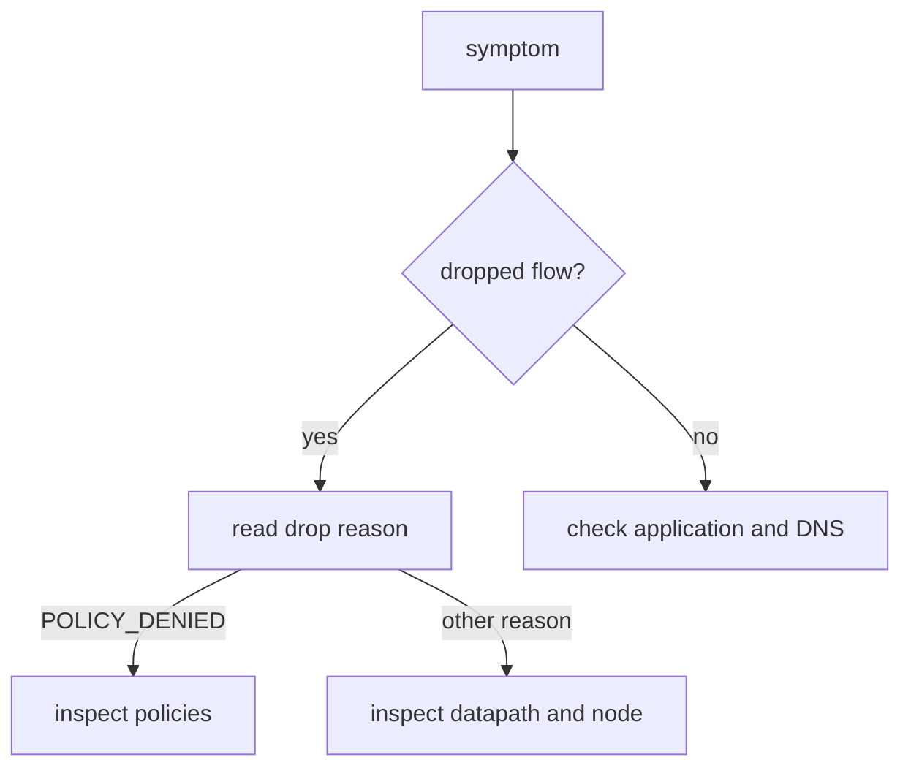

# Start With The Verdict

A report such as "the pod cannot reach the service" does not say where to look. The first useful fact is whether the network dropped the traffic or let it through. Hubble answers this with the verdict. This part gives the first step of the method and the list of drop reasons.

## Step one: dropped or forwarded

Run a filter for dropped flows. If the list is not empty, the network refused something, and the next question is which pair of pods. If the list is empty for the affected pod, the network did not drop the traffic, and the cause lies in the application, in a name lookup or in a node outside Cilium.

<!-- astrona:playground:renew -->

```sh
kubectl -n kube-system exec ds/cilium -c cilium-agent -- hubble observe --verdict DROPPED --last 10
```

Each line has the time, the source, the destination, the type and the reason in brackets or after the verdict. Look for the pods in your complaint. In the playground, the lines show `outpost/rogue` and `outpost/drifter` as sources and `starfleet/probe` as destination.

## Read the drop reason

The drop reason names the check that dropped the packet. The reasons you meet most often are:

- `POLICY_DENIED`: a network policy has no rule that allows this traffic. This is the normal result of a policy that works.
- `UNSUPPORTED_L3_PROTOCOL`: the packet uses a protocol that the datapath does not handle.
- `INVALID_SOURCE_IP` and `INVALID_PACKET_DROPPED`: the packet has an address or a form that the datapath rejects.
- `STALE_OR_UNROUTABLE_IP`: the destination address does not belong to an endpoint that the agent knows, for example a deleted pod.
- `CT_MAP_INSERTION_FAILED`: the connection tracking table is full or could not accept an entry.
- `UNKNOWN_L4_PROTOCOL` and `UNSUPPORTED_L2_PROTOCOL`: the transport or link layer is not supported.

Print the reason in a form that you can search. The JSON output has the field `drop_reason_desc`:

```sh
kubectl -n kube-system exec ds/cilium -c cilium-agent -- hubble observe --verdict DROPPED --last 1 -o json
```

The reason tells you which direction to take. A `POLICY_DENIED` drop leads to the policies. The other reasons lead to the datapath, the node or the state of the endpoint.

## Narrow to the pair

Once you know the pair, filter to it and show both directions. A request needs a path out and a path back, and a policy can drop the reply:

```sh
kubectl -n kube-system exec ds/cilium -c cilium-agent -- hubble observe --pod outpost/rogue --pod starfleet/probe --last 10
```

Look for the first flow of the connection, usually a packet with the SYN flag. If it is dropped, the connection never starts. If the SYN is forwarded and later packets are dropped, something between the endpoints changed during the connection.



The diagram shows the first decision of the method: the verdict decides whether you look at the network or elsewhere.

You now can tell whether the network dropped the traffic and why. If the reason is a policy, the next question is which policy and which direction decided.

## Common pitfalls

> [!WARNING]
> A dropped flow from a policy that works as intended is not a fault. An empty drop list does not prove that the application is healthy, only that the network did not drop the traffic. Old drops stay in the buffer, so check the time. Reading only one direction can hide a dropped reply.
