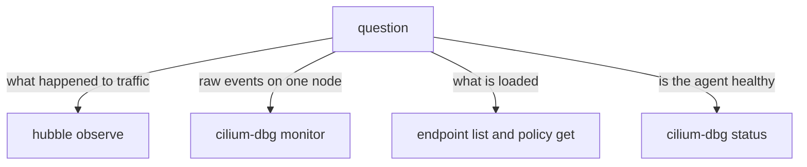

# Hubble Compared With The Agent Monitor

Hubble is not the only view of the datapath. Each Cilium agent has a built-in monitor, and the agent can list the state it holds. Hubble is built from the same events, but it adds names, filters, history and cluster-wide views. This part shows when each tool is the right one.

## The agent monitor

The command `cilium-dbg monitor` runs in the agent pod and prints the events of the datapath as they happen. It shows drop events, trace events and policy verdict events for the node, as raw lines. It has no history and no pod names; it shows endpoint numbers and identities. It does not need Hubble or Relay, so it works when Hubble is off.

Run it for a few seconds, with the filter for drops, and stop it with Control-C:

<!-- astrona:playground:renew -->

```sh
kubectl -n kube-system exec ds/cilium -c cilium-agent -- cilium-dbg monitor --type drop
```

You see a drop line each time `rogue` sends its request. The line shows the endpoint, the identity of the source and the reason. Compare this with `hubble observe --verdict DROPPED`: Hubble shows the same event with pod names, labels and a time stamp.

## Other agent commands

The agent can show state that flows do not show. These commands help when a flow says "denied" and you want to see what the agent holds:

```sh
kubectl -n kube-system exec ds/cilium -c cilium-agent -- cilium-dbg endpoint list
kubectl -n kube-system exec ds/cilium -c cilium-agent -- cilium-dbg policy get
kubectl -n kube-system exec ds/cilium -c cilium-agent -- cilium-dbg status
```

The endpoint list shows each endpoint with its identity and whether ingress and egress enforcement is on. The policy command prints the rules that the agent has loaded. The status command shows the health of the agent and of its components, including Hubble.

## When to use which

Use Hubble when you want names, history, filters or the view of the whole cluster. Use the monitor when Hubble or Relay is down, when you want the raw events without any filter on the node, or when you suspect that Hubble loses events because the buffer is too small. Use the endpoint and policy commands when the question is what the agent has loaded and not what happened to a packet.



The diagram shows four questions and the command that answers each.

## The method in one list

The whole method has five steps. Check the verdict. Read the drop reason. For a policy drop, find the endpoint and the direction from the policy verdict. For a name problem, read the DNS flows and the response codes. Change one thing, and check the same flows again. This list works the same way for every problem in this domain.

You now have a complete method and know which tool to take at each step.

## Common pitfalls

> [!WARNING]
> The monitor prints a lot on a busy node, so always filter by type and stop it with Control-C. It shows events only from the moment you start, so an event from before is gone. The old command name `cilium` inside the agent pod is replaced by `cilium-dbg` in current releases. The policy that the agent holds can differ from the policy objects if the agent has not yet synchronised a recent change.
